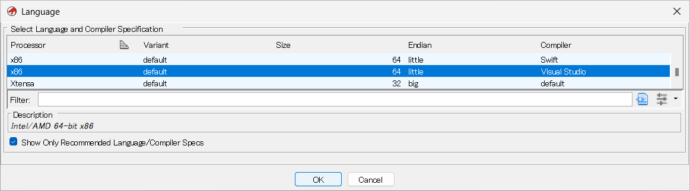
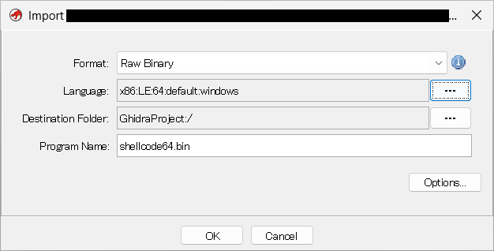
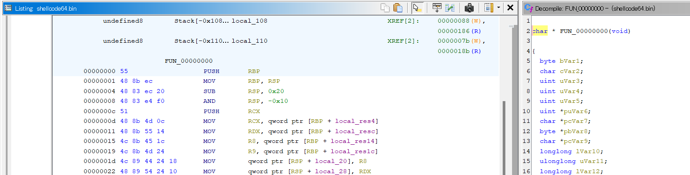
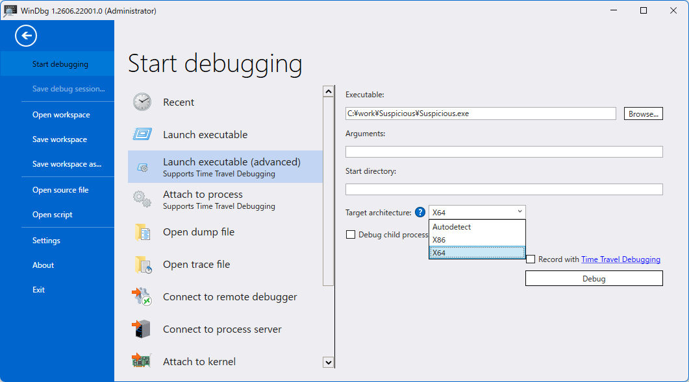
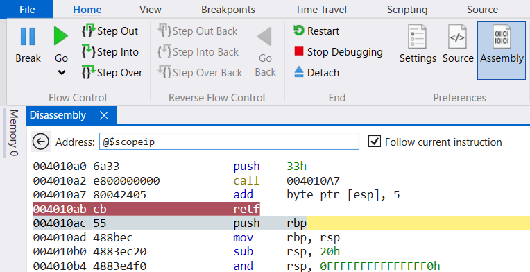

# Suspicious 問題の writeup

この問題は、RAT (Remote Access Tool) を模した EXE ファイルの動作を解析する問題です。本問題の EXE ファイルでは、マルウェアでしばしば用いられるテクニックをいくつか使用しています。

- Heaven's Gate
- API Hashing
- `ntdll.dll`中関数の使用
- LZNT1 圧縮、伸長
- RC4 暗号化、復号
- WinHTTP を使った HTTP 通信

以降、`Suspicious.exe`のイメージベースが、仮想アドレス`0x400000`であることを前提として、各種アドレスを記述します。その際、`VA`という用語は仮想アドレスを意味します。

## 初動解析

問題文でも初動解析の記述があるものの、念のためここでもバイナリの特徴を簡単に調べます。

例えば <https://ntcore.com/explorer-suite/> で公開されている`CFF Explorer`を使うと、次のようなことが分かります。

- 32-bit の EXE ファイルであること
- インポートしている DLL は次の内容であること
  - `KERNEL32.dll`
  - `VCRUNTIME140.dll`
  - `WINHTTP.dll`
  - `api-ms-win-crt-runtime-l1-1-0.dll`等のいくつかの API セット系 DLL (詳細: <https://learn.microsoft.com/en-us/windows/win32/apiindex/windows-apisets#api-set-contract-names>)

しかし、各種 DLL からインポートしている関数を調べても、不審な動作につながりそうな関数は WinHTTP 系の各種関数だけに見受けられます。

また、`Optional Header`の`DllCharacteristics`の値を調べると、`CFF Explorer`の表示では`DLL can move`にチェックが入っていることが分かります。そのチェックは、<https://learn.microsoft.com/en-us/windows/win32/api/winnt/ns-winnt-image_optional_header32> に記述のある`IMAGE_DLLCHARACTERISTICS_DYNAMIC_BASE`ビットが立っていることを表します。EXE ファイルに当該ビットが立っている場合、EXE ファイルを実行するごとに EXE 自身のベースアドレスが変化します。静的解析には影響しないものの、デバッガー等を使う場合には当該ビットを 0 に設定して EXE ファイルを保存しなおしておくと便利です。`CFF Explorer`は書き換えや再保存に対応しています。

## capaを使った初期解析

<https://github.com/mandiant/capa> という解析ツールがあります。`capa`を使うことで、より高度な表層解析ができます。加えて、`-v`オプションを指定することで、検知された関数の具体的なアドレスも得られます。例えば次のような結果を得られます。

```text
$ capa -v Suspicious/Suspicious.exe
...(snip)...
64-bit execution via heavens gate (5 matches)
namespace    anti-analysis/anti-disasm
description  Looks for instructions related to executing 64-bit code from a 32-bit process (Heaven's Gate)
scope        function
matches      0x401000
             0x401040
             0x4010A0
             0x401180
             0x4013C0
...(snip)...
```

検知された関数を調べると、冒頭で`PUSH 0x33`命令や`RETF`命令が使われていることが分かります。それらの命令の用途を調べると、まさに Heaven's Gate と呼ばれる手法で使われる命令と分かります。

なお、`capa`を使わない場合でも、解析を進めるうちに`PUSH 0x33`命令や`RETF`命令を発見することを想定しています。

## Heaven's Gate の入り口と出口

Heaven's Gate 手法の詳細は、インターネットにいくつか存在します。例えば日本語で記述されている文献の例として <https://www.mbsd.jp/research/20171214/downloader/> が存在します。

手法を調べると、`PUSH 0x33`命令や`RETF`命令が実行された後は、64-bit として命令を実行することが分かります。しかし、`Suspicious.exe`は 32-bit EXE ファイルであるため、通常の逆アセンブラ等は 32-bit 命令としてのみ逆アセンブルします。試しに`RETF`命令の後を 32-bit 命令として逆アセンブルしても、`DEC EAX`が頻出する点で不自然な内容を得られます。加えて VA`0x401180`の関数の場合は、関数途中に`RETF`命令が現れる点で、同様に不自然な内容を得られます。

Heaven's Gate を通して実行される内容を解析するには、64-bit 命令として逆アセンブルする必要があります。そのためには、例えば次のような方法があります。

1. Ghidra で`Suspicious.exe`を開き、逆アセンブル結果が表示される`Listing`ウィンドウにおいて、Heaven's Gate 箇所の`RETF`命令の直後から、関数の終わりの方と判断できる箇所までを範囲選択します。
1. 範囲選択した状態で`Listing`中で右クリックして、表示されるコンテキストメニュー中の`Copy Special...`をクリックします。
1. 表示される`Copy Special`ダイアログから、`Python Byte String`を選択して、`OK`ボタンをクリックします。すると、クリップボードへ内容がコピーされます。
1. Python のインタープリター等を使って、コピーしたバイト列を、バイナリ形式としてファイルへ保存します。ここでは`shellcode64.bin`として保存したものとします。
1. 保存したバイナリ形式のファイルを Ghidra へインポートします。インポート時の`Language`には、`x86:LE:64:default:windows`を指定します。なお`Language`選択時のダイアログでは、`Compiler`箇所には`windows`ではなく`Visual Studio`と表示されます。
   - 
   - 
1. Ghidra へのインポートが完了したら CodeBrowser で開きます。`Listing`ウィンドウではまだ逆アセンブルされていない状態なので、キーボードの`D`キーを押して逆アセンブルします。また、追加で`F`キーを押して、関数として認識させます。
   - 

他の方法として、`shellcode64.bin`として保存したものを <https://github.com/accidentalrebel/shcode2exe> を使って 64-bit EXE へ変換してから Ghidra へインポートして逆アセンブルする方法もあります。

このような方法で、Heaven's Gate を通じて実行される 64-bit 命令を解析できます。

Heaven's Gate を通じて実行される 64-bit 命令を読むと、5 つの関数すべてで次のような末尾になっていることが分かります。

```text
    CALL       LAB_00000223
LAB_00000223
    MOV        dword ptr [ESP  + 0x4 ], 0x23
    ADD        dword ptr [ESP ], 0xf
    RETF
    RET
```

Heaven's Gate を通じて 32-bit 側から 64-bit 側へ遷移するときは`0x33`という値を使って`RETF`命令を実行します。一方で今回は、`0x23`という値を使って`RETF`命令を実行しています。`0x23`の値の意味を調査すると、`0x23`とは Heaven's Gate 手法を使って後続の命令を 32-bit 版の命令として実行するための値と分かります。また、32-bit 命令へ遷移するための`RETF`命令の後には`RET`命令を実行しており、関数の呼び出し側視点では 32-bit の状況が保たれていることが分かります。このように、VA`0x401000`等の関数 5 個は、Heaven's Gate 手法を使って、それらの関数内部の一部のみを 64-bit 命令として実行しています。

## WinDbg を使ったHeaven's Gate前後の実行方法

Heaven's Gate は解析妨害に使われることがあります。特に 32-bit と 64-bit を入れ替える効果は、デバッガーによる解析を妨げます。例えば`RETF`命令にブレークポイントを設定してその位置まで実行を進めてから 1 命令だけステップ実行しようとしても、全然違うところでブレークしたり、ブレークせずに実行を続けたりすることがあります。

一方で WinDbg を使うと、`RETF`命令を超えてステップ実行できます。WinDbg は、GUI アプリケーションではあるものの、コマンド操作を中心とした操作体系です。癖は強いですが機能は強力です。WinDbg の概要は <https://learn.microsoft.com/en-us/windows-hardware/drivers/debuggercmds/windbg-overview> 等を、操作方法は <https://learn.microsoft.com/en-us/windows-hardware/drivers/debuggercmds/commands> 等を参照ください。

次の手順で、Heaven's Gate 後の 64-bit 命令をデバッグ実行できます。

1. Microsoft Store から WinDbg をインストールします。(参考: <https://apps.microsoft.com/detail/9PGJGD53TN86>)
   - なお、 <https://learn.microsoft.com/en-us/windows-hardware/drivers/debugger/> で最初に紹介されている`Install WinDbg directly`の方法では、WinDbg Classic をダウンロードしてしまいます。ご注意ください。
1. WinDbg を起動し、メニューの`File → Start debugging → Launch executable (advanced)`の順に遷移します。`Executable`に`Suspicious.exe`を指定し、`Target architecture`に`X64`を設定します。
   - 通常では WinDbg は、デバッグ対象のバイナリに応じてデバッガー側の対象ビット数を自動的に設定します。通常ではこの挙動で問題ありませんが、今回は Heaven's Gate を超えてデバッグ実行するために、設定の変更が必要です。
   - 
1. WinDbg で、`Suspicious.exe`のデバッグ実行を開始すると、Heaven's Gate を超えて 64-bit 命令を実行する前後でも、ステップ実行等ができます。
   - たとえば、`RETF`命令がある VA`0x4010AB`にブレークポイントを設定するために`bp 004010AB`コマンドを実行し、`g`コマンドで VA`0x4010AB`まで実行を進めた場合を考えます。
     1. `r cs`コマンドを実行して`cs`レジスタの値を確認すると、`0x23`であることを確認できます。
     1. `t`コマンドを実行してステップ実行すると、正常に`RETF`命令の次のアドレスで一時停止します。
     1. あらためて`r cs`コマンドを実行して`cs`レジスタの値を確認すると、`0x33`に変化していることを確認できます。
1. なお、64-bit 命令を実行する段階でも、逆アセンブル表示が 32-bit 命令のことがあります。その場合は、逆アセンブル表示上の方にある`Address`箇所に、いったん`0`等の適当なアドレスを入力してから、あらためて`@$scopeip`を入力して戻ってくると、64-bit 命令として逆アセンブルされます。また、`u rip`コマンドを実行することでも64-bit 命令として逆アセンブルできます。
   - 

## Heaven's Gate 手法を使う 5 個の関数の機能

`Suspicious.exe`中の多くの処理は、前述の Heaven's Gate を使う 5 つの関数を使用しています。それら 5 つの関数の機能を解明することが重要です。

解析する手順として、前述した方法で 64-bit 命令として逆アセンブルや逆コンパイルする方法や、WinDbg でデバッグ実行や型を確認する方法があります。

解析する際、次の点が重要です。

- 32-bit 側から Heaven's Gate を実行するときのレジスタやスタックの状態等を考慮して、64-bit 側の実行内容も解析する必要があります。
- `MOV RAX, qword ptr GS:[0x60]`のようにアクセスされる`GS:[0x60]`には、64-bit 版 PEB のアドレスがあります。
- PEB 中には読み込み済みモジュールのリストが存在します。
  - PEB 等の各種データ構造の詳細は、WinDbg が 64-bit モードであるときに`dt ntdll!_PEB`コマンド等を実行すると、各種メンバーの名称やオフセットを簡単に確認できます。
- 各種 DLL の先頭アドレスは、`IMAGE_DOS_HEADER`構造体です。<https://learn.microsoft.com/en-us/windows/win32/debug/pe-format> 等に記述があるように、各種 DLL がエクスポートする関数のリストを探索できます。
- 各種 DLL がエクスポートしている関数を`Suspicious.exe`が探索するとき、関数名そのものは使っていません。代わりに API Hashing と呼ばれる手法で検索しています。API Hashing の詳細は後述します。

API Hashing では、関数名から計算したハッシュ値のみをファイルへ埋め込みます。実行時に各種 DLL がエクスポートする関数のリストを探索する際も同様にハッシュ値を計算して、想定する関数かどうかを判別する手法です。
`Suspicious.exe`では VA`0x401180`の関数中で、各種 DLL のエクスポート関数を探索しています。その際、`0xCBF29CE484222325`や`0x100000001B3`をハッシュ値計算に使用しています。それらの値で調査すると、FNV-1a と呼ばれるハッシュアルゴリズムの 64-bit 版であることが分かります。FNV-1a は <https://datatracker.ietf.org/doc/rfc9923/> の`The FNV Non-Cryptographic Hash Algorithm`という名称の RFC 9923 で記述されています。

前述した観点で解析すると、Heaven's Gate を使用する 5 つの関数は次の機能を持つことが分かります。

Virtual Address | 機能
--- | ---
`0x401000` | 64-bit 版 PEB の`ProcessHeap`を取得します。
`0x401040` | 64-bit 版 PEB の`ProcessParameters`中にある`ConsoleHandle`の値を引数の値に設定し、古い値を取得します。
`0x4010A0` | 64-bit 版 PEB から、読み込み済み 64-bit モジュールを探索し、引数で指定されたモジュールのベースアドレスを取得します。
`0x401180` | 引数で指定された 64-bit モジュールのベースアドレスから、引数で指定された API Hashing 済みのハッシュ値と一致する関数のアドレスを取得します。
`0x4013C0` | 引数で指定された 64-bit 関数のアドレスを、64-bit モードで実行します。引数にも対応しています。

## API Hashing による API 解決結果の解析

`Suspicious.exe`の処理を解析すると、VA`0x401440`の関数中で、前述の Heaven's Gate 手法を使う VA`0x4010A0`やVA`0x401180`の関数を使って、64-bit 版の DLL のイメージベース取得や、64-bit 版の関数のアドレス取得を行っていることが分かります。取得結果を構造体の各種メンバーへ格納します。

WinDbg で VA`0x401440`の関数の末尾である VA`0x401A26`へブレークポイントを設定して、`dq eax L0n24`コマンドを実行すると、`eax`レジスタが指すアドレスから 10 進数で 24 要素分の 64-bit 値を表示できます。取得できた 64-bit 値それぞれについて、次のように確認できます。

- ``!address 00007ff9`2f060000``のように`!address`コマンドを実行すると、指定アドレスを含むモジュールの情報を取得できます。アドレスがモジュールの先頭アドレスに一致している場合は、そのモジュールのアドレスを指すメンバーと考えられます。
- `!address`コマンドや`lm`コマンドを実行すると、各種モジュールのアドレス一覧を取得できます。
  - WinDbg で確認したアドレスが、いずれかのモジュールの先頭アドレスに一致している場合は、そのモジュールのアドレスを指すメンバーと考えられます。
- ``ln 00007ff9`2f0cede0``のように`ln`コマンドを実行すると、指定アドレスに近いシンボルのアドレスと名称を取得できます。`ln`コマンドで指定したアドレスがシンボルのアドレスと一致する場合は、そのシンボルのアドレスを指すメンバーだと考えられます。
  - 例えば`(2f0cede0)   ntdll!LdrLoadDll   |  (2f0cf0c0)   ntdll!RtlGetImageFileMachines`の出力を得られた場合は、下位 4 バイトが`ntdll!LdrLoadDll`側と同一アドレスであるため、`LdrLoadDll`関数のアドレスを指すメンバーだと考えられます。

そのように WinDbg で確認すると、次のような結果を得られます。なお`Kernel32_d60000!LoadLibraryAStub`のようにアドレスが含まれている箇所は、実行ごとに変化します。

バイト単位のオフセット | 内容(いずれも64-bit版)
--- | ---
0x00 | `ntdll.dll`の先頭アドレス
0x08 | `ntdll!LdrLoadDll`関数のアドレス
0x10 | `ntdll!RtlExitUserProcess`関数のアドレス
0x18 | `ntdll!memcpy`関数のアドレス
0x20 | `ntdll!RtlAllocateHeap`関数のアドレス
0x28 | `ntdll!RtlFreeHeap`関数のアドレス
0x30 | `ntdll!RtlGetCompressionWorkSpaceSize`関数のアドレス
0x38 | `ntdll!RtlCompressBuffer`関数のアドレス
0x40 | `ntdll!RtlDecompressBuffer`関数のアドレス
0x48 | `ntdll!RtlFreeAnsiString`関数のアドレス
0x50 | `ntdll!RtlDosPathNameToNtPathName_U_WithStatus`関数のアドレス
0x58 | `ntdll!NtCreateFile`関数のアドレス
0x60 | `ntdll!NtReadFile`関数のアドレス
0x68 | `ntdll!NtClose`関数のアドレス
0x70 | `ntdll!NtDelayExecution`関数のアドレス
0x78 | `Kernel32.dll`の先頭アドレス
0x80 | `Kernel32_d60000!LoadLibraryAStub`関数のアドレス
0x88 | `Kernel32_d60000!GetProcAddressStub`関数のアドレス
0x90 | `Kernel32_d60000!MultiByteToWideCharStub`関数のアドレス
0x98 | `Kernel32_d60000!GetComputerNameA`関数のアドレス
0xA0 | `AdvApi32.dll`の先頭アドレス
0xA8 | `CRYPTSP!SystemFunction032`関数のアドレス
0xB0 | `CRYPTBASE!SystemFunction036`関数のアドレス
0xB8 | `AdvApi32!GetUserNameA`関数のアドレス

`ntdll.dll`中の関数のいくつかは、Microsoft 社の公式サイトではドキュメント化されていません。しかしインターネット検索等で、関数の機能や引数、戻り値等の十分な情報を得られます。

名前からは機能が分かりづらい関数もあります。`SystemFunction032`関数は、RC4 暗号化を行う関数であり、公式にはドキュメント化されていません。`SystemFunction036`関数は、 <https://learn.microsoft.com/en-us/windows/win32/api/ntsecapi/nf-ntsecapi-rtlgenrandom> では`RtlGenRandom`関数としてドキュメント化されています。

なお WinDbg で解決する以外の方法として、各種 DLL がエクスポートしている関数名について API Hashing 結果を計算し、VA`0x401440`の関数中で使用しているハッシュ値と対応する関数名を探す方法もあります。

## `Suspicious.exe`の処理内容の解析

API Hashing の解析結果を構造体として作成して適用し、`Suspicious.exe`の他の処理の内容を解析します。解析結果だけを述べると、次の内容と分かります。

- VA`0x402660`の関数は、引数のバッファを LZNT1 で圧縮して、RC4 で暗号化する関数です。
  - VA`0x4026F5`の`call`命令で呼び出している、VA`0x401BA0`の関数中で、`RtlCompressBuffer`を呼び出しています。
    - `RtlCompressBuffer`の引数を調査すると、第 1 引数が`0x102`です。これは、`COMPRESSION_FORMAT_LZNT1`である`0x002`と、`COMPRESSION_ENGINE_MAXIMUM`である`0x100`のビット和です。
  - VA`0x402796`の`call`命令で呼び出している、VA`0x401E10`の関数中で、`SystemFunction032`を呼び出して RC4 処理を行います。
    - RC4 の鍵には、VA`0x4051D8`にある 16 バイトのバイト列と、ランダム生成した 16 バイトのバイト列を結合します。
  - ランダム生成した 16 バイトのバイト列と、「LZNT1 で圧縮して、その後 RC4 で暗号化した」バイト列を結合した結果を、引数へ書き込みます。
- VA`0x402820`の関数は、引数のバッファを RC4 で復号して、LZNT1 で伸長する関数です。
  - VA`0x402974`の`call`命令で、`SystemFunction032`を呼び出して RC4 処理を行います。
    - RC4 の鍵には、VA`0x4051D8`にある 16 バイトのバイト列と、バッファの先頭 16 バイトのバイト列を結合します。
  - VA`0x4029EE`の`call`命令で、`RtlDecompressBuffer`を呼び出して LZNT1 で伸長します。
    - `RtlDecompressBuffer`の引数を調査すると、第 1 引数が`2`です。これは、`COMPRESSION_FORMAT_LZNT1`である`0x002`を表します。
- VA`0x402A20`の関数は、ランダムな 16 バイトを生成し、`GetUserNameA`や`GetComputerNameA`で実行環境情報を収集して、後述の Type-Length-Value 形式でバッファへ書き込む関数です。
- VA`0x401F00`の関数は、HTTP で POST リクエストを送信して、受信する HTTP レスポンスのボディを引数へ書き込む関数です。
- VA`0x402BC0`の関数は、後述の Type-Length-Value 構造の受信 C2 コマンドを実行して、その結果を Type-Length-Value 構造の引数へ書き込む関数です。

`Suspicious.exe`における Type-Length-Value 構造は、各種データを次のバイト列で表す方式です。

- 4 バイトの Type 値。詳細は後述します。
- 4 バイトの Length 値。これは Value のバイト単位の長さを表します。
- Length バイトの Value 値。これがデータの本体です。

`Suspicious.exe`では次の Type を扱います。

Type | 意味
--- | ---
0x000 | VA`0x402A20`の関数でランダムに生成した16バイトです。Victim ID を想定しています。
0x001 | `GetUserNameA`関数で収集したユーザ名です。
0x002 | `GetComputerNameA`関数で収集したコンピュータ名です。
0x100 | C2 コマンドまたはレスポンスの ID です。詳細は後述します。
0x102 | C2 コマンドまたはレスポンスの引数です。詳細は後述します。
0xffffffff | 未使用です。適当な乱数データです。

C2 コマンドまたはレスポンスでは、次の ID や引数を扱います。

ID | 処理内容 | 引数
--- | --- | ---
0 | HeartBeat です。特段何も行いません。 | 未使用です。
1 | 終了です。`Suspicious.exe`を終了させます。 | 未使用です。
2 | ファイル読み込みです。引数で指定されたパスのファイルを読み込み、ファイルの内容を返します。 | C2 コマンド時は UTF-8 形式のファイルパス、レスポンス時はファイル内容です。

## C2 通信内容の復号

ここまでで C2 通信の内容を解明できたので、`captured.pcapng`ファイルの内容を復号できます。復号すると、C2 コマンドの ID 2 の命令が 1 つ含まれていて、コマンド引数は`C:\secret\flag.bmp`の内容を取得するものです。そのレスポンスの内容を復号すれば、BMP 形式の画像ファイルを入手できます。当該 BMP 画像に、本問題のフラグが記載されています。

- LZNT1 の圧縮や伸長には、`Suspicious.exe`同様に`RtlCompressBuffer`関数や`RtlDecompressBuffer`関数を使う方法や、Python スクリプトの場合は <https://github.com/you0708/lznt1> を使う方法があります。
- 同様に、RC4 の暗号化や復号には、`Suspicious.exe`同様に`SystemFunction032`関数を使う方法や、Python スクリプトの場合は <https://pycryptodome.readthedocs.io/en/stable/src/cipher/arc4.html> を使う方法があります。
- `captured.pcapng`ファイル内容から HTTP リクエストや HTTP レスポンスの内容を読み込むには、Wireshark を使う方法や、Python スクリプトの場合は <https://scapy.readthedocs.io/en/stable/> を使う方法があります。

Python スクリプトを使って、`captured.pcapng`ファイルに含まれる HTTP 通信から BMP 画像を復元して保存する例を、[solve.py](solve.py) に示します。
