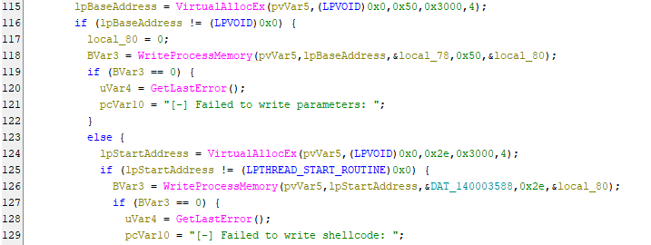
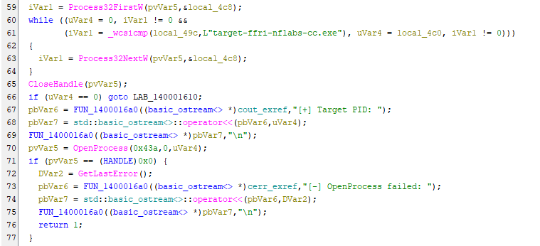
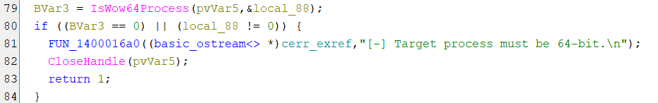
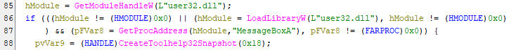
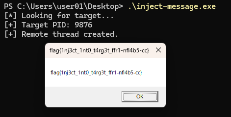

# 解法

コードや文字列を確認するとProcess Injectionに利用されがちな関数群が利用されていることがわかる。



また、以下の部分で`target-ffri-nflabs-cc.exe`という名前の64bitプロセスが動作しているかを確認し、見つかった場合に`OpenProcess`で開いていることを確認できる。



64bitプロセスであるかどうかについては、`IsWow64Process`関数で確認を行っている。



なお、対象プロセスでの`MessageBoxA`の利用のために、`user32.dll`のロード有無についても確認していそうなこともわかる。



ここまでの確認結果から、`user32.dll`がロードされた`target-ffri-nflabs-cc.exe`というプロセスを起動したうえで当該バイナリを実行すると、何らかの処理がインジェクトされて実行されることが分かる。

`target-ffri-nflabs-cc.exe`を準備する方法には、適当なEXEファイルの名前を変更する方法や、以下のようなソースファイルを64-bitとしてビルドする方法がある。

```cpp
#include <Windows.h>

int WINAPI WinMain(HINSTANCE, HINSTANCE, LPSTR, int) {
    HMODULE user32 = LoadLibraryW(L"user32.dll");
    if (user32 == nullptr) {
        return 1;
    }
    
    while (true) {
        Sleep(1000);
    }

    return 0;
}
```

`target-ffri-nflabs-cc.exe`を実行している状態で`inject-message.exe`を実行すると、フラグが表示される。

