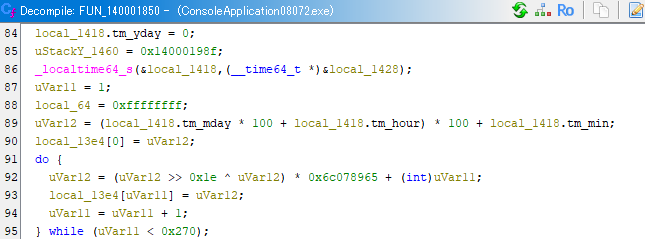

# Writeup - vuln_ransomware

フラグ: flag{pr3d1ct4bl3_s33d_br34ks_crypt0}

## 概要
暗号化された flag.txt を復号し、ファイルの中に記載されたフラグを読む問題です。

本プログラムは暗号化アルゴリズムの1つであるSalsa20アルゴリズムを用いて、flag.txtの暗号化を行いました。Salsa20アルゴリズムの32バイトkey・8バイトnonceの生成には、std::mt19937を用いました。またstd::mt19937のseed値として、プログラム実行時の日時（日・時・分）を組み合わせた値が用いられていました。

日・時・分の組み合わせは 31 × 24 × 60 = 44,640 通りしかなく、全seed値のパターンでkeyおよびnonceを生成してファイルを復号できるかを試すことは、短時間で完了します。本解説の末尾にあるソルバーでは筆者環境では約15秒で復号できました。


本プログラムには現実のマルウェアでも見られるような、動的解析を難しくするための以下の耐解析技術が組み込まれていました。
- cpuidを利用した、VM環境検知

一方で、ツールを活用すると耐解析技術を回避できます。例えばx64dbgには、ブレークポイントごとに、レジスタなどの値を書きかえる等のコマンドを実行できる機能が備わっています。このような機能を使用することで上記の耐解析技術を回避しつつ解析できます。

「Salsa20」・「std::mt19937」・「cpuidを用いた耐解析技術」は、以下のような方法で特定することを想定していました。

### Salsa20 の特定
ファイルの暗号化が行われている関数0x140001660の逆コンパイル結果を確認すると、内部で関数0x140001000が呼ばれていることを確認できます。関数0x140001000を確認すると関数中に`0x3320646e`・`0x79622d32`といった値が使用されています。これらの値をGoogle検索すると、ChaCha20やSalsa20のアルゴリズムで使用されているという情報が見つかります。

関数140001000を詳細に調べると、第1引数を8ブロック分、第2引数を2ブロック分使うことや、ROR命令の第2オペランドとして`0x19`・`0x17`・`0x13`・`0x0E`が使われていることが分かります。

ChaCha20の仕様を含む[RFC 8439: ChaCha20 and Poly1305 for IETF Protocols](https://www.rfc-editor.org/info/rfc8439/)中の、`2.1. The ChaCha Quarter Round`を参照すると、`<<<=`記号で表現される左方向へビット回転するビット数が`16`・`12`・`8`・`7`であり、回転するビット数も今回の関数とは異なることが分かります。また、`2.3. The ChaCha20 Block Function`を参照すると、keyが8ブロックであることは一致するものの、nonceが3ブロックであるため今回の関数とは異なることが分かります。これらから、今回の関数はChaCha20ではないことを予測できます。

次にSalsa20の仕様である[Salsa20 specification](https://cr.yp.to/snuffle/spec.pdf)を参照します。`1 Introduction`に`4-byte words`という記述があることから、Salsa20では1ワードを4バイトと表現していることが分かります。`3 The quarterround function`を参照すると、`<<<`記号で表現される左方向へビット回転するビット数が`7`・`9`・`13`・`18`と分かります。ワードサイズが4バイト、すなわち32ビットであるため、ビット回転する方向を反対にすると、今回の関数の回転ビット数と一致することが分かります。また、`10 The Salsa20 encryption function`を参照すると、`Let k be a 32-byte or 16-byte sequence. Let v be an 8-byte sequence`や`nonce v under key k`の記述があることから、keyとnonceのブロック数と一致します。これらの特徴を考慮したり手元で実験したりすることで、Salsa20アルゴリズムで暗号化していると予測できます。

### std::mt19937 の特定
関数0x140001660の第1引数・第2引数の生成箇所を追っていくと、以下の処理が確認できます。



ここで登場する定数`0x6c078965`を直接Google検索するとmt19937乱数生成の記事がヒットします。seed値と思われる画像中の`uVar12`を固定したりして実験すると、関数0x140001660の第1引数・第2引数の生成にはstd::mt19937が使用されていると予測できます。


### cpuidを用いた耐解析技術 の特定
プログラムの序盤に、eax=0x40000000としてcpuid命令が呼ばれています。「cpuid 0x40000000」などで検索すると、このcpuid命令がハイパーバイザーのベンダーIDを取得するために使用されていることを確認できます。

ransomware.exeは、取得するベンダーIDが次のいずれかを含む場合、暗号化動作を行わずに終了します。

- VMware
- VBox
- TCG
- KVM

これらのベンダーIDは、仮想環境で使われることがあります。そのためransomware.exeはベンダーIDを使って解析環境を検知する、耐解析を行っていると言えます。


## フラグ導出スクリプト

ここまでで解説した通り、Salsa20のkeyやnonceは、実行時の日・時・分をseedとするmt19937で生成されます。日・時・分を総当たりしつつflag.txtの復号を試み、フラグフォーマットであるflag{}形式の平文を探索すると、フラグを導出できます。フラグを導出するPythonスクリプトの例を以下に示します。
```python
import struct

MASK32 = 0xFFFFFFFF

class MT19937:

    N = 624
    M = 397
    MATRIX_A = 0x9908B0DF
    UPPER_MASK = 0x80000000
    LOWER_MASK = 0x7FFFFFFF

    def __init__(self, seed: int) -> None:
        self.mt = [0] * self.N
        self.mt[0] = seed & MASK32
        for i in range(1, self.N):
            x = self.mt[i - 1]
            self.mt[i] = (0x6C078965 * (x ^ (x >> 30)) + i) & MASK32
        self.index = self.N

    def _twist(self) -> None:
        for i in range(self.N):
            y = (self.mt[i] & self.UPPER_MASK) | (
                self.mt[(i + 1) % self.N] & self.LOWER_MASK
            )
            value = self.mt[(i + self.M) % self.N] ^ (y >> 1)
            if y & 1:
                value ^= self.MATRIX_A
            self.mt[i] = value & MASK32
        self.index = 0

    def next_u32(self) -> int:
        if self.index >= self.N:
            self._twist()

        y = self.mt[self.index]
        self.index += 1

        y ^= y >> 11
        y ^= (y << 7) & 0x9D2C5680
        y ^= (y << 15) & 0xEFC60000
        y ^= y >> 18
        return y & MASK32


def rotl32(value: int, count: int) -> int:
    return ((value << count) | (value >> (32 - count))) & MASK32


def salsa20_block(key: bytes, nonce: bytes, counter: int) -> bytes:
    if len(key) != 32:
        raise ValueError("Salsa20 key must be 32 bytes")
    if len(nonce) != 8:
        raise ValueError("Salsa20 nonce must be 8 bytes")

    sigma = b"expand 32-byte k"
    k = struct.unpack("<8I", key)
    n0, n1 = struct.unpack("<2I", nonce)
    c0 = counter & MASK32
    c1 = (counter >> 32) & MASK32
    s = struct.unpack("<4I", sigma)

    state = [
        s[0], k[0], k[1], k[2],
        k[3], s[1], n0, n1,
        c0, c1, s[2], k[4],
        k[5], k[6], k[7], s[3],
    ]
    x = state.copy()

    for _ in range(10):
        x[4] ^= rotl32((x[0] + x[12]) & MASK32, 7)
        x[8] ^= rotl32((x[4] + x[0]) & MASK32, 9)
        x[12] ^= rotl32((x[8] + x[4]) & MASK32, 13)
        x[0] ^= rotl32((x[12] + x[8]) & MASK32, 18)

        x[9] ^= rotl32((x[5] + x[1]) & MASK32, 7)
        x[13] ^= rotl32((x[9] + x[5]) & MASK32, 9)
        x[1] ^= rotl32((x[13] + x[9]) & MASK32, 13)
        x[5] ^= rotl32((x[1] + x[13]) & MASK32, 18)

        x[14] ^= rotl32((x[10] + x[6]) & MASK32, 7)
        x[2] ^= rotl32((x[14] + x[10]) & MASK32, 9)
        x[6] ^= rotl32((x[2] + x[14]) & MASK32, 13)
        x[10] ^= rotl32((x[6] + x[2]) & MASK32, 18)

        x[3] ^= rotl32((x[15] + x[11]) & MASK32, 7)
        x[7] ^= rotl32((x[3] + x[15]) & MASK32, 9)
        x[11] ^= rotl32((x[7] + x[3]) & MASK32, 13)
        x[15] ^= rotl32((x[11] + x[7]) & MASK32, 18)

        x[1] ^= rotl32((x[0] + x[3]) & MASK32, 7)
        x[2] ^= rotl32((x[1] + x[0]) & MASK32, 9)
        x[3] ^= rotl32((x[2] + x[1]) & MASK32, 13)
        x[0] ^= rotl32((x[3] + x[2]) & MASK32, 18)

        x[6] ^= rotl32((x[5] + x[4]) & MASK32, 7)
        x[7] ^= rotl32((x[6] + x[5]) & MASK32, 9)
        x[4] ^= rotl32((x[7] + x[6]) & MASK32, 13)
        x[5] ^= rotl32((x[4] + x[7]) & MASK32, 18)

        x[11] ^= rotl32((x[10] + x[9]) & MASK32, 7)
        x[8] ^= rotl32((x[11] + x[10]) & MASK32, 9)
        x[9] ^= rotl32((x[8] + x[11]) & MASK32, 13)
        x[10] ^= rotl32((x[9] + x[8]) & MASK32, 18)

        x[12] ^= rotl32((x[15] + x[14]) & MASK32, 7)
        x[13] ^= rotl32((x[12] + x[15]) & MASK32, 9)
        x[14] ^= rotl32((x[13] + x[12]) & MASK32, 13)
        x[15] ^= rotl32((x[14] + x[13]) & MASK32, 18)

    return struct.pack("<16I", *[((x[i] + state[i]) & MASK32) for i in range(16)])


def salsa20_xor(data: bytes, key: bytes, nonce: bytes) -> bytes:
    out = bytearray(len(data))
    for counter, offset in enumerate(range(0, len(data), 64)):
        stream = salsa20_block(key, nonce, counter)
        chunk = data[offset : offset + 64]
        out[offset : offset + len(chunk)] = bytes(a ^ b for a, b in zip(chunk, stream))
    return bytes(out)


def derive_material(seed: int) -> tuple[bytes, bytes]:
    rng = MT19937(seed)
    generated = bytes(rng.next_u32() & 0xFF for _ in range(40))
    return generated[:8], generated[8:]  # nonce, key


def main() -> None:
    with open('flag.txt', 'rb') as f:
        ciphertext = f.read()

    for day in range(1, 32):
        for hour in range(24):
            for minute in range(60):
                seed = day * 10000 + hour * 100 + minute
                nonce, key = derive_material(seed)

                plaintext = salsa20_xor(ciphertext, key, nonce)
                if plaintext.startswith(b"flag{") :
                    print(f"flag: {plaintext.decode()}")
                    return


if __name__ == "__main__":
    main()

```
