# Writeup — Whereabouts

## はじめに

本問題は、画像から手掛かりを見つけ出し、公開情報と照合することで、撮影場所の特定や画像の真偽の検証に取り組む力を養うことを目的としています。

- 画像を漫然と見るのではなく、調査につながる手掛かり（登録記号、建物、風景など）を意識して抽出する習慣を身につける。
- 画像検索やキーワード検索を活用し、複数の公開情報を照合して、根拠に基づく結論を導く力を養う。
- AI生成画像が普及する中で、画像を鵜呑みにせず、複数の情報源を用いて真偽を検証する姿勢を身につける。

本解説は、2026年10月2日時点で確認した公開情報に基づいて記載しています。

## ミッション1: Airport Identification

画像を調査し、撮影された空港の名称を特定する問題です。

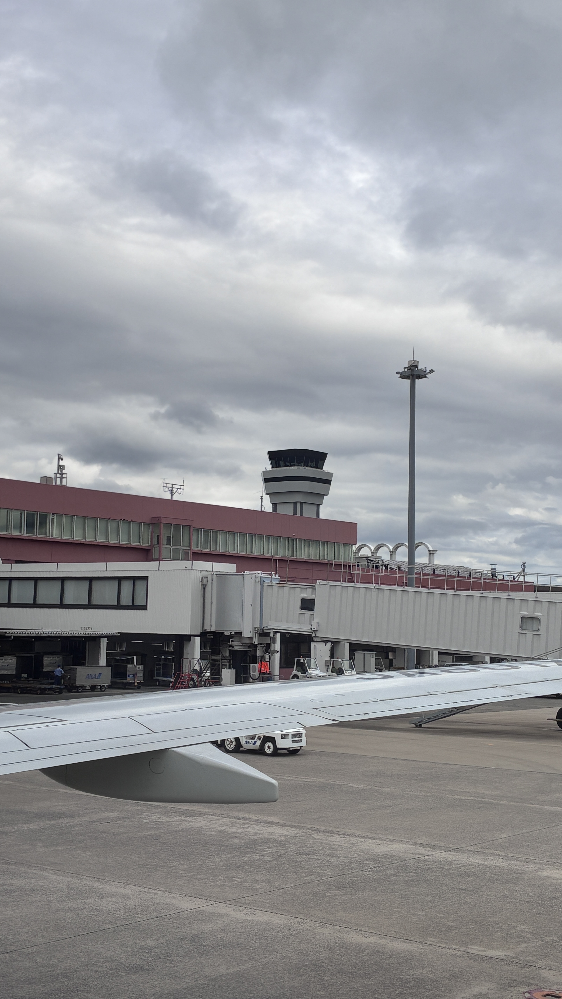

### 1. 画像の特徴を整理する

注目すべき特徴として、次の点があります。

- 赤色の外観を持つビルが写っています。
- 飛行機の翼に、何らかの文字列が描かれています。
  - 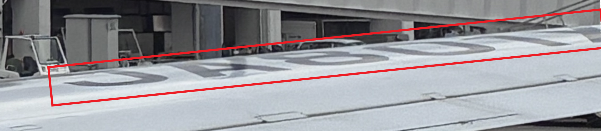

### 2. 飛行機の登録記号を特定する

飛行機の翼に描かれている文字列は`JA801X`や`JA807X`、`JABOIy`等のように見えます。ここで「飛行機 JA 意味」などで調査すると、[航空法施行規則（昭和二十七年運輸省令第五十六号）](https://laws.e-gov.go.jp/law/327M50000800056/20220310_503M60000800076#Mp-Ch_6-At_133)において、次の記述が見つかります。

```text
第百三十三条　航空機の国籍は、装飾体でないローマ字の大文字ＪＡ（以下「国籍記号」という。）で表示しなければならない。
第百三十四条　法第五条の規定による登録記号（以下「登録記号」という。）は、装飾体でない四箇のアラビア数字又はローマ字の大文字で表示しなければならない。
...
第百三十六条　登録記号は、国籍記号の後に連記しなければならない。
第百三十七条　国籍記号及び登録記号の表示の方法及び場所は、左の通りとする。
...
イ　主翼面にあつては、右最上面及び左最下面に表示し、主翼の前縁及び後縁より等距離に配置し、国籍記号及び登録記号の頂は、主翼の前縁に向けるものとする。...
```

また、国土交通省のサイトの[航空：〇 よくある質問（ＦＡＱ） - 国土交通省](https://www.mlit.go.jp/koku/koku_tk1_000038.html)ページでも、次の記述が見つかります。

```text
「航空機の登録記号」は、新規登録時に国が付与する記号番号のことで、「ＪＡ〇〇〇〇」と表記されます。
```

これらの記述から、飛行機の翼に描かれている文字列は、国籍記号および登録記号である可能性が浮上します。先頭2文字は、まさに`JA`であり、国籍記号と一致します。

続いて、登録記号について調査すると、[航空：その他の手続きなど - 国土交通省](https://www.mlit.go.jp/koku/koku_tk1_000036.html)ページ中の`登録記号の付番ルールについては、こちらをご覧ください。`箇所でリンクされている、`登録記号取扱規則（抜粋）（平成８年より運用）`資料に、次の記述が見つかります。

```text
○ローマ字については「I」、「O」、「S」、「CC」、「JA」を含むものは使用できない。
  使用可能パターンは、数字を○、ローマ字を△とすると、JA○○○△もしくは
  JA○○△△の２パターンに限る。
```

この記述から、登録記号にはローマ字の`I`や`O`は使用できないことや、登録記号の1～2文字目は数字、3文字目は数字またはローマ字、4文字目はローマ字であることが分かります。また、前述の`航空法施行規則`から、ローマ字の場合は大文字であることも分かります。

これらの情報を元に、画像中の飛行機の翼に描かれている登録記号を検討すると、候補として次のものが挙げられます。

- `801X`
- `807X`

次に、登録記号を検証します。登録記号についての扱いを国土交通省のサイトから検索すると、[航空：その他の手続きなど - 国土交通省](https://www.mlit.go.jp/koku/koku_tk1_000036.html)ページに`すでに使用されている登録記号については、こちらをご覧ください`という記述が見つかります。その記述にある資料を閲覧すると、`801X`と`807X`の両方が`登録中`であることを確認できます。

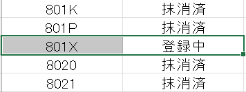

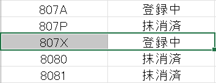

これらの調査結果から、飛行機の国籍記号および登録記号が`JA801X`または`JA807X`らしいことを考慮して、今後の調査を行います。

### 3. 候補となる空港を検索する

`JA801X`で検索すると、[JA801X - Boeing 737-81D - Solaseed Air - Flightradar24](https://www.flightradar24.com/data/aircraft/ja801x)などのページが見つかります。

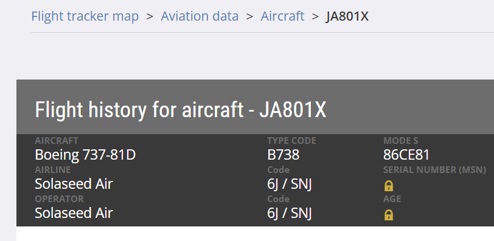

同様に`JA807X`で検索すると、[JA807X - Boeing 737-81D - Solaseed Air - Flightradar24](https://www.flightradar24.com/data/aircraft/ja807x)などのページが見つかります。

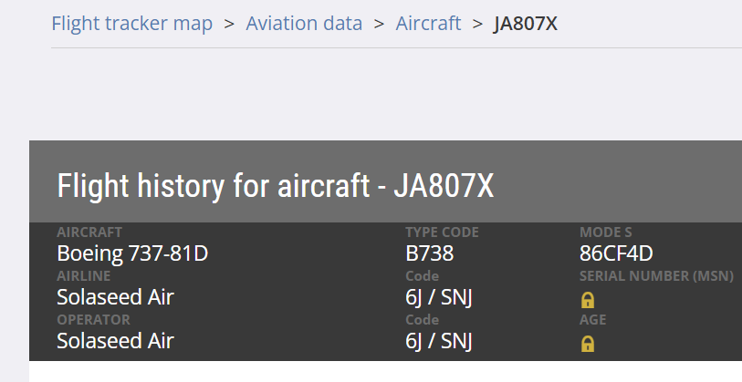

ページの記述から、本問題の画像の飛行機が`JA801X`と`JA807X`のどちらである場合でも、Solaseed Airが保有する機体であることが分かります。Solaseed AirのWebサイトを調査すると、[航空券 予約／空席照会／運賃案内｜ソラシドエア](https://www.solaseedair.jp/)ページに次の記述が見つかります。

```text
“九州・沖縄の翼”として地域に根差した活動を行っています
```

この記述から、Solaseed Airは日本の九州や沖縄を中心に就航していることを推測できます。以降、「ソラシドエア」と表現します。

ソラシドエアのWebサイトの調査を続けると、[空港案内｜空港・機内サービス｜ソラシドエア](https://www.solaseedair.jp/service/airport/)ページで次の画像が見つかります。

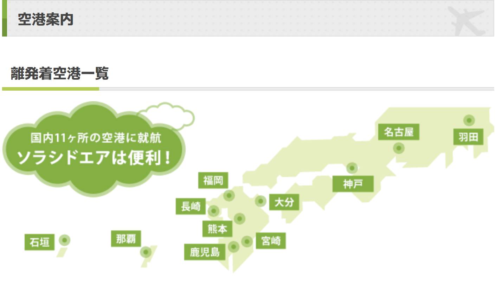

この画像から、ソラシドエアは国内11箇所の空港に就航していることが分かります。

### 4. 11箇所の空港と照合する

ここまでの調査から、本問題の画像が撮影された空港は、ソラシドエアが就航している11箇所の空港のいずれかであると分かりました。ここからは、それぞれの空港について、本問題の画像に存在する次の要素と比較していきます。

- ターミナルビルの外観
- 管制塔の形状

11箇所の空港のうち長崎空港については、[ランウェイウォークをおこないました【5/27】｜新着情報｜長崎空港](https://nagasaki-airport.jp/news/detail.php?id=909)のように、ターミナルビルが赤系の外観であり、かつ管制塔の形状が一致することから、本問題の画像の撮影場所であると考えられます。一方で他の10箇所の空港については、画像と一致する特徴が見受けられません。

これらのことから、本問題の画像の撮影場所は長崎空港と判断できます。

### 回答とフラグ

本問題のターゲットマシンへアクセスして、`長崎空港`と回答すると、次のフラグが表示されます。

```text
flag{n1c3_41rp0r7_1d}
```

## ミッション2: Photo Recovery

日本国内を旅行中にカメラが壊れ、失われた5枚の写真を記憶をもとにAIで復元したという設定の問題です。実際にカメラで撮影した写真1枚と、AIで復元した画像5枚の計6枚から実写の写真を特定し、その撮影地点の緯度・経度を特定する問題です。

| 画像番号 | 画像内容 |
| --- | --- |
| 01 | 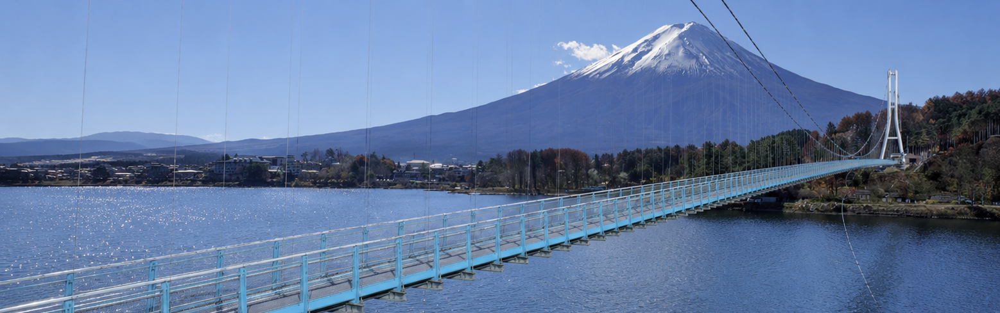 |
| 02 | 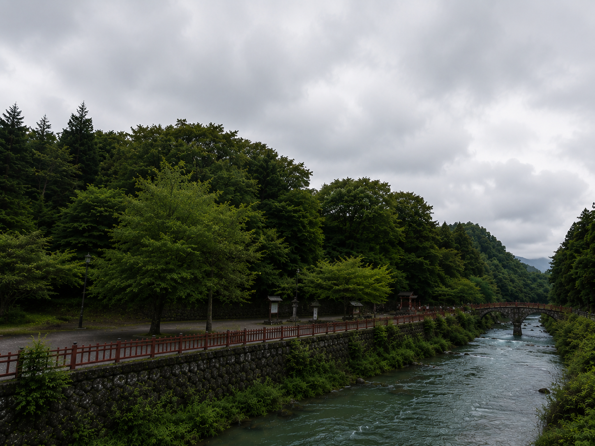 |
| 03 | 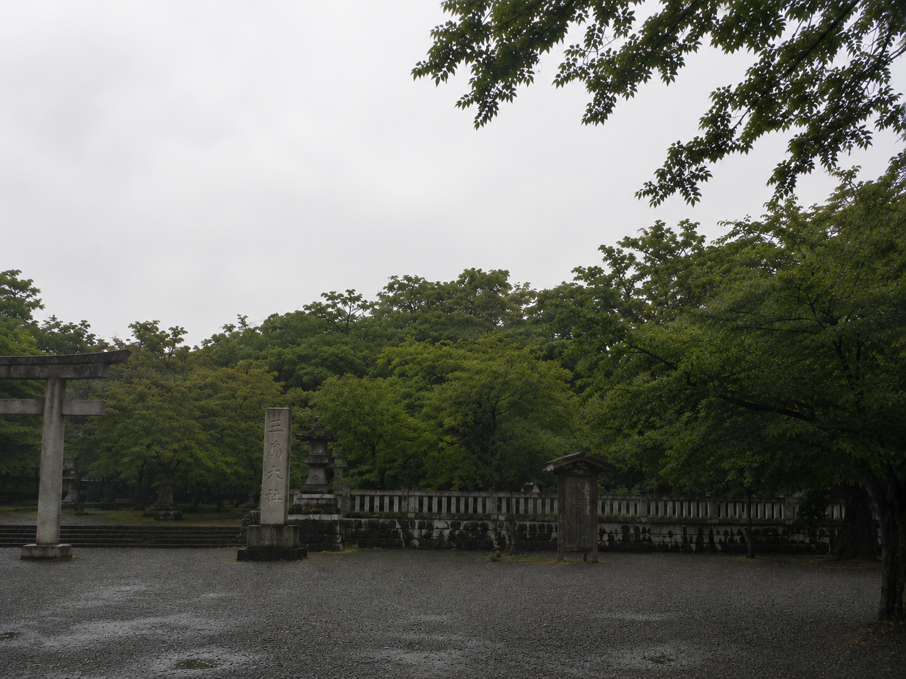 |
| 04 | 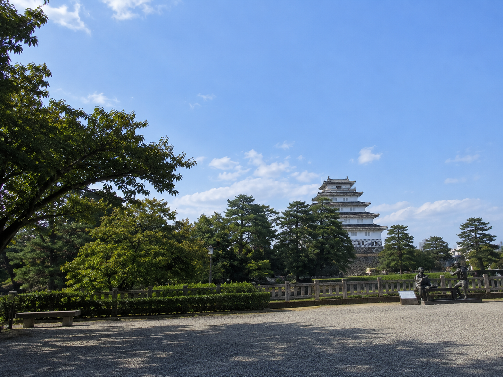 |
| 05 | 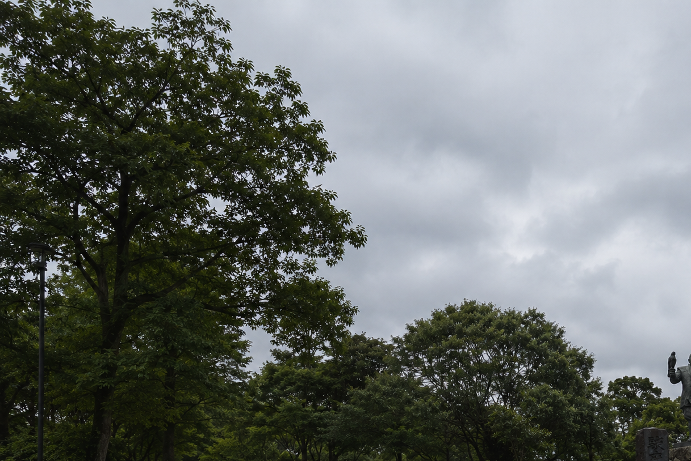 |
| 06 | 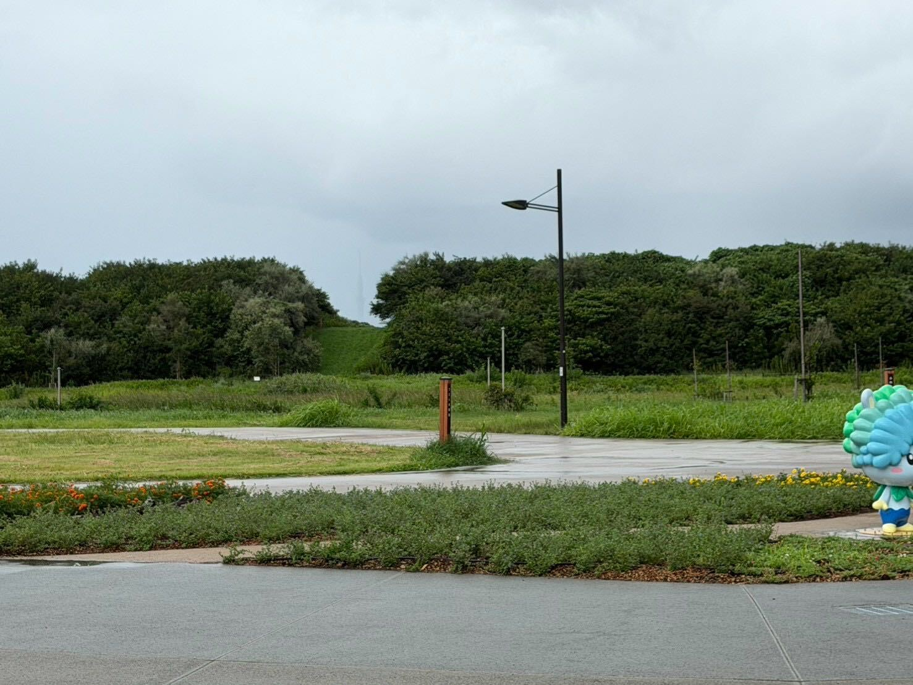 |

この問題は、大きく2段階に分けて調査します。

1. 6枚の中から実写画像を特定する
2. 実写画像に写っている場所を特定し、座標を調べる

### 1. 各画像を調査する

AIが生成する画像には、次のような不自然な点が表れることがあります。

- 文字、看板、石碑が崩れる
- 建物の窓、柱、手すりなどの反復する構造が崩れる
- 木の枝、水面、人物、像の細部が崩れる
- 光源、影、反射の整合性が崩れる
- 遠近感や物体同士の関係性が崩れる

本問題の各画像について、前述の点が表れていればAIが生成した画像らしいと判断できます。また、画像検索で類似の写真が見つかる場合、それらの写真と比較することでも判定できます。

各画像の調査結果を次の表にまとめます。

| 画像番号 | 写っている場所の候補 | 判定 | 根拠 |
| --- | --- | --- | --- |
| 01 | 三島スカイウォーク | AI生成 | 本問題の画像では、吊橋の下には水面が広がっています。しかし[写真ダウンロード \| 絶景と発散。 富士山を望む大吊橋 三島スカイウォーク](https://mishima-skywalk.jp/contact/dl/)などに掲載されている画像では、吊橋の下には森林が広がっています。 |
| 02 | 神橋 | AI生成 | 本問題の画像では、川の真ん中に橋の支柱があります。しかし[神橋｜体験・観光スポット　｜【公式】日光市の観光サイト　日光旅ナビ](https://www.nikko-kankou.org/spot/21)などに掲載されている画像では、橋に支柱はありません。 |
| 03 | 三嶋大社 | AI生成 | 本問題の画像では、社号標に刻まれている神社名が`三島大社`であり、2文字目が`島`です。しかし[アクセス \| 三嶋大社](https://www.mishimataisha.or.jp/access)などに掲載されている画像では、刻まれている神社名が`三嶋大社`であり、2文字目が`嶋`です。 |
| 04 | 海の森公園 | 実写 | 本問題の画像の右側に写るマスコットキャラクター「うみのもりすけ」を手掛かりに、[海の森公園](https://uminomoripark.com/)であると特定できます。他の5枚はAIが生成したものらしいと判断できるため、残る本画像が実写であると分かります。 |
| 05 | 駿府城公園 | AI生成 | 本問題の画像の右下に写っている銅像は、弥次喜多像に似ています。このことから駿府城公園らしいと判断できます。本問題の画像では、中央に5階建て以上の大きな城が写っています。しかし[フォトギャラリー - 【公式】駿府城公園](https://sumpu-castlepark.com/gallery/)などに掲載されている画像を見ても、そのような建物はありません。 |
| 06 | 徳川家康公の像 | AI生成 | 本問題の画像の右下に写っている像は、駿府城公園にある徳川家康公の像に似ています。本問題の画像では、鳥が止まっているのは徳川家康公の右腕です。しかし[＜家康彩々＞　家康の足跡　訪ねる：中日新聞しずおかWeb](https://www.chunichi.co.jp/article/665483)などに掲載されている画像では、鳥が止まっているのは左腕です。 |

これらの調査結果から、04の画像が実写と判断できます。

### 2. 緯度・経度を取得する

海の森公園の公式サイトに掲載されているSNSアカウントを確認すると、[Instagramの投稿](https://www.instagram.com/p/DWD4o5ZmhJm/?img_index=1)が見つかります。この内容から、「うみのもりすけ」のフォトスポットが、坂の上広場に設置されたことが分かります。

[公園概要 – 【公式】海の森公園](https://uminomoripark.com/about/)の公園マップから、坂の上広場の位置が分かります。地図サービスを使って座標を調べると、およそ次の座標であることが分かります。

- 緯度: 35.607
- 経度: 139.808

なお、本問題では緯度・経度ともに小数点以下2桁まで使用され、3桁目以降は切り捨てられます。小数点以下2桁の範囲では、海の森公園のほぼ全域が該当します。

### 回答とフラグ

本問題のターゲットマシンへアクセスして、`{35.60, 139.80}`と回答すると、次のフラグが表示されます。

```text
flag{n1c3_g30l0c4710n}
```
